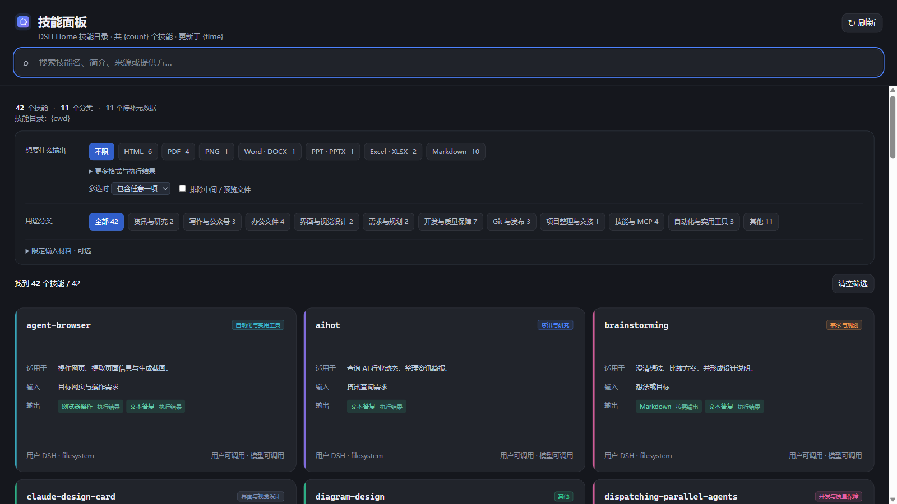
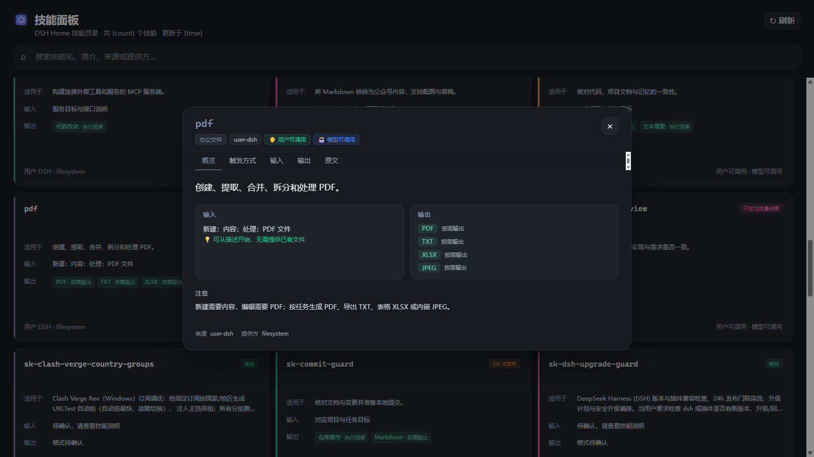
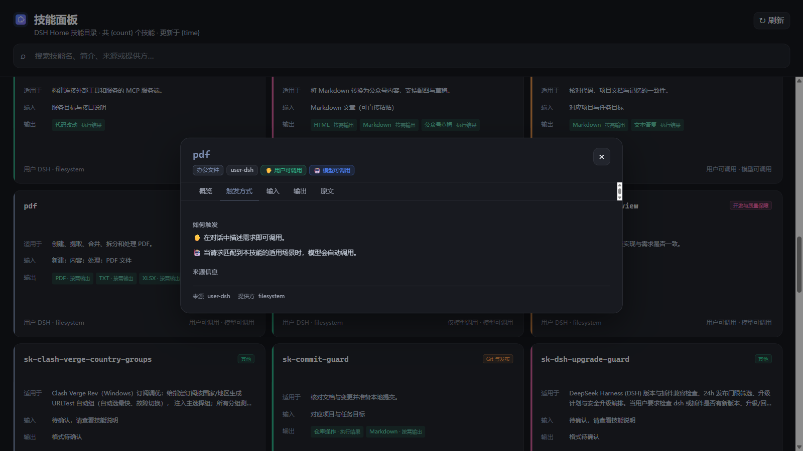
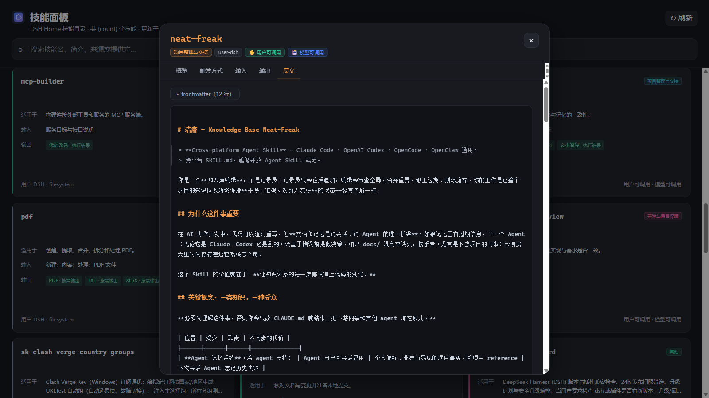

<p align="center"></p>

<h1 align="center">DSH Skill Browser</h1>

<p align="center">浏览、理解与排查 DeepSeek Harness 的技能库——本地只读、零侵入、即装即用的 <a href="https://github.com/deepseek-ai/deepseek-harness">DSH</a> 技能面板插件。</p>

<p align="center">
  
  
  
</p>

<p align="center">
  <a href="#下载安装推荐">下载最新版</a> · <a href="#功能">功能</a> · <a href="#使用示例">使用示例</a> · <a href="#安全边界与限制">安全边界</a> · <a href="#环境要求">环境要求</a>
</p>

> [!NOTE]
> 当前版本兼容 DeepSeek Harness `>=0.2.1-rc.4 <0.3.0-0`，开发与发布依赖固定为已实测的 `0.2.1-rc.4`。DSH 仍处于 Developer Preview：0.2.x 的后续版本由兼容范围直接覆盖，0.3 起须重新验证并更新范围。

## 目录

- [界面预览](#界面预览)
- [功能](#功能)
- [使用示例](#使用示例)
- [安全边界与限制](#安全边界与限制)
- [环境要求](#环境要求)
- [下载安装（推荐）](#下载安装推荐)
- [从源码安装（开发者）](#从源码安装开发者)
- [开发安装与即时验证](#开发安装与即时验证)
- [开发与验证](#开发与验证)

## 界面预览

| 面板总览 · 筛选与统计 | 详情弹窗 · 结构化信息 |
| --- | --- |
|  |  |

| 触发方式 · 调用指引 | 原文 · frontmatter 折叠与行标记 |
| --- | --- |
|  |  |

## 功能

- 以一级侧栏面板提供入口（与插件、上下文洞察同列），面板占满中央区域，不依赖具体会话。
- 只浏览 DSH Home 的 `<DSH_HOME>/skills/*/SKILL.md`，不读取项目目录或当前会话的技能注册表。
- 按技能名、简介、适用场景、来源和提供方搜索。
- 现有 41 个技能使用已审核的 10 类用途映射；未收录技能显示在“其他”，输入输出格式标为待确认。
- 按输出格式与输入材料筛选：输出支持任意/全部匹配，跨组条件同时满足，可排除中间/预览产物。
- 卡片展示“适用于、输入、可选、输出”，区分主要交付、按需输出与中间产物；长描述与多余格式在卡片内截断，完整信息在详情弹窗呈现。
- 顶部概览条：单行展示技能总数、分类数与待补元数据计数；点击待补元数据即筛选出缺审核标注的技能，来源等单一取值的维度自动隐藏。
- 配色基于 DSH 主题令牌与稳定名称调色板，同一技能在卡片、图表与详情中保持同一强调色，自动适配深色与浅色主题。
- 无结果时提供带结果数量的放宽条件建议；点击卡片打开详情弹窗，按概览、触发方式、输入、输出、原文五个页签梳理展示，无内容的页签自动隐藏。
- 支持 YAML 多行简介、UTF-8 BOM 和 Windows 换行；缺少简介时显示占位提示，元数据解析失败时保留技能并在详情中显示原因。
- 按需以纯文本查看 `SKILL.md`（frontmatter 默认折叠，标题与引用按行轻量标记，不解析行内语法）、路径、来源、提供方和元数据。
- 通过 SSE 接收目录变化通知并自动刷新。
- 支持中文和英文、键盘操作、焦点循环、`Esc` 关闭弹窗和移动端布局。

## 使用示例

**找技能**：启动 DSH Web，点击左侧栏的“技能面板”。顶部搜索框支持技能名、简介、适用场景、来源和提供方；按 `/` 可直接聚焦搜索框。

**缩小范围**：在筛选区选择“想要什么输出”（如 PDF、Markdown，可多选并切换任意/全部匹配）、用途分类，或展开“限定输入材料”按输入类型过滤；需要排查未审核技能时，点击概览条中的“待补元数据”计数。

**看细节**：点击任意卡片打开详情弹窗，五个页签分别回答不同问题——概览（这是什么、输入输出摘要）、触发方式（用户如何调用、模型何时自动调用、触发词）、输入、输出、原文（`SKILL.md` 原样内容，frontmatter 默认折叠）。`Esc` 关闭弹窗并把焦点送回原卡片。

## 安全边界与限制

插件只读，不改变 DSH 与技能目录的任何内容：

- 只提供目录、详情与事件流三个 `GET` 端点，不提供写入、安装或删除能力。
- 详情只能读取 DSH Home 目录中已经枚举的技能名，不能提交任意文件路径。
- 技能正文和元数据只作为 React 文本及 `<pre>` 内容显示，不执行其中的 HTML 或脚本。
- 请求会校验回环连接、回环 Host、完整同源协议及浏览器来源提示。
- 响应字段、正文长度和 SSE 连接数量均有上限；断开或出现背压时会释放连接。

以下能力有意不提供：

- 不安装、启用、禁用或删除技能，也不修改任何 `SKILL.md`。
- 不读取项目目录、当前会话注册表或技能目录以外的文件。
- 不渲染技能正文中的 Markdown 与 HTML（原文保留为纯文本，避免引入 HTML 注入面），也不加载技能目录内的图片或附件。
- 不联网、不调用模型，所有数据来自本机 DSH Home。

安全问题请不要公开披露，参见 [SECURITY.md](SECURITY.md)。

## 环境要求

- Node.js 22 或更高版本。
- DeepSeek Harness `>=0.2.1-rc.4 <0.3.0-0`（0.2.x 后续版本无需更换插件；更早的 DSH 或 0.3 起的版本请使用对应版本的插件）。
- npm。

## 下载安装（推荐）

> 适合：只想使用插件的普通用户。不需要 Git、Node.js 或源码。

从 [v0.1.11 Release](https://github.com/young-yyj/dsh-skill-browser/releases/tag/v0.1.11) 安装已构建的包，无需 Git、下载源码或自行编译。当前已在 Windows 上验证，以下命令使用 PowerShell。

先执行 `dsh --version`，确认输出在 `0.2.1-rc.4` 至 `0.2.x` 的兼容范围内。然后复制以下命令，下载到 DSH Home、校验文件并安装：

```powershell
$ErrorActionPreference = 'Stop'
$version = '0.1.11'
$file = "dsh-skill-browser-$version.tgz"
$baseUrl = "https://github.com/young-yyj/dsh-skill-browser/releases/download/v$version"
$dshRoot = if ($env:DSH_HOME) { $env:DSH_HOME } else { Join-Path ([Environment]::GetFolderPath('UserProfile')) '.dsh' }
$archiveDir = Join-Path $dshRoot 'local-packages/dsh-skill-browser'
New-Item -ItemType Directory -Force -Path $archiveDir | Out-Null
$tarball = Join-Path $archiveDir $file
$checksumFile = Join-Path $archiveDir "SHA256SUMS-$version"
Invoke-WebRequest "$baseUrl/$file" -OutFile $tarball
Invoke-WebRequest "$baseUrl/SHA256SUMS" -OutFile $checksumFile
$checksums = [Text.Encoding]::UTF8.GetString([IO.File]::ReadAllBytes($checksumFile))
$match = [regex]::Match($checksums, '(?m)^([a-fA-F0-9]{64})  ' + [regex]::Escape($file) + '\r?$')
if (!$match.Success) { throw 'Checksum entry missing' }
if ((Get-FileHash -LiteralPath $tarball -Algorithm SHA256).Hash -ne $match.Groups[1].Value) { throw 'SHA256 mismatch; installation stopped' }
dsh plugin --profile web add $tarball --save-exact
if ($LASTEXITCODE -ne 0) { throw 'DSH installation failed' }
```

停止已运行的 DSH Web，再启动：

```powershell
dsh web --no-open
```

启动后在左侧栏点击“技能面板”。本插件只展示你自己 DSH Home 中的 `skills/<技能名>/SKILL.md`，不附带技能文件。

### 更新、回退与卸载

- 更新：先查看目标 Release 的 DSH 兼容版本，使用该版本的安装命令，然后重启。保留旧 `.tgz`。
- 回退：对已保存的旧 `.tgz` 重新执行 `dsh plugin --profile web add <旧包完整路径> --save-exact`，然后重启；旧插件也必须匹配当前 DSH 版本。
- 卸载：执行 `dsh plugin --profile web remove dsh-skill-browser`，然后重启。不会删除你的技能文件。

出现发布时间或完整性检查错误时，不要添加安全例外。peer 依赖告警需结合重启后的加载结果判断；反馈问题时请附 DSH 版本、插件版本和错误信息，勿附令牌或凭据。

## 从源码安装（开发者）

> 适合：想在另一台电脑上从源码构建使用的开发者。

稳定版插件安装在 DSH Home 的本地包目录中，与本仓库解耦；因此可以移动、删除或重新克隆本仓库，而不影响日常使用的 `web` profile。

其他电脑首次安装时，先安装上述 Node.js、DSH 和 Git，然后在 PowerShell 中下载源码并构建：

```powershell
git clone https://github.com/young-yyj/dsh-skill-browser.git
cd dsh-skill-browser
dsh --version
npm ci
npm run verify
```

确认 `dsh --version` 与环境要求一致后，在项目目录执行以下安装命令。首次安装无需递增插件版本：

```powershell
$dshRoot = if ($env:DSH_HOME) { $env:DSH_HOME } else { Join-Path ([Environment]::GetFolderPath('UserProfile')) '.dsh' }
$archiveDir = Join-Path $dshRoot 'local-packages/dsh-skill-browser'
New-Item -ItemType Directory -Force -Path $archiveDir | Out-Null
$pack = npm pack --json --pack-destination $archiveDir | ConvertFrom-Json
$tarball = Join-Path $archiveDir $pack[0].filename
dsh plugin --profile web add $tarball --save-exact
```

然后重启稳定版 DSH Web：

```powershell
dsh web --no-open
```

打开终端显示的地址，在左侧栏点击“技能面板”入口。技能文件应位于 DSH Home 的 `skills/<技能名>/SKILL.md`。

后续安装仓库更新时，先执行 `git pull --ff-only`、`npm ci`、`npm run verify`，再重复打包、安装和重启步骤。开发者发布自己的修改时，先执行 `npm version patch --no-git-tag-version`，再验证、打包并提交版本变更。每次发布保留上一版本 `.tgz`，以便回退。

如果安装被发布时间或完整性策略阻止，应等待包满足策略或排查安装来源，不要添加安全例外。安装成功不等于运行验证通过；若有 peer 依赖告警，请在重启后检查插件加载和界面。

## 开发安装与即时验证

> 适合：参与本插件开发、需要边改边看的贡献者。

开发 profile 使用源码链接，不影响稳定 `web` profile。首次创建开发环境：

```powershell
dsh plugin --profile web-dev add "link:$PWD" --save-exact
```

日常开发时，修改代码后执行：

```powershell
npm run build
dsh --profile web-dev web
```

重新启动开发版 Web，即可在左侧栏验证“技能面板”入口和浏览器功能。开发 profile 依赖当前源码目录；稳定 profile 不依赖该目录。

## 开发与验证

```powershell
npm ci
npm run verify
npm pack --dry-run
```

`npm run verify` 会依次执行类型检查、全部测试以及 Host/Client 生产构建。

分类、输入与输出资料在 `src/skill-metadata.ts` 中维护，筛选逻辑在 `src/client/skill-filters.ts` 中维护。新增或更新技能后，应核对其说明再更新映射；不能仅凭正文出现的文件扩展名认定输出能力。技能原文件始终只读。

版本 0.1.11 将 DSH 兼容声明从精确版本改为范围 `>=0.2.1-rc.4 <0.3.0-0`，并把 peer、开发与运行依赖精确对齐到已实测的 `0.2.1-rc.4`；Cordis 保持 `4.0.5`，业务源码零改动。此后 0.2.x 的 DSH 更新不再需要逐版本发布插件，0.3 起仍需复测并扩大范围。升级验证记录见 [DSH 兼容性验证](docs/architecture/dsh-compatibility.md)。稳定安装后仍需重启 DSH Web，完成运行环境复核。

参与开发前请阅读 [CONTRIBUTING.md](CONTRIBUTING.md)。

架构说明：[技能目录与安全边界](docs/architecture/dsh-home-skills-catalog.md)、[稳定与开发环境分离](docs/architecture/dsh-profile-separation.md)。历史实施计划保留在本地 `docs/superpowers/plans/`，不纳入版本控制。

---

本项目基于 [MIT 许可证](LICENSE) 发布。
